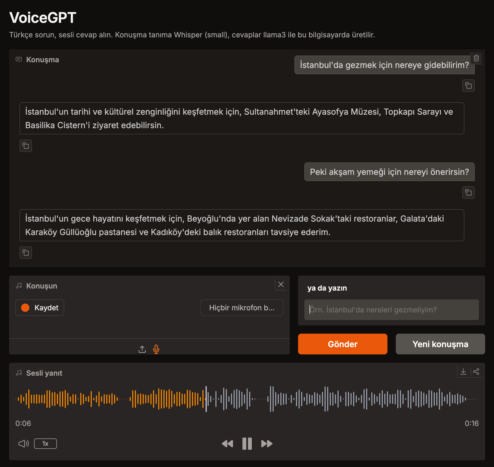

<p align="center">
  
</p>

A Turkish voice assistant: speak, and it answers in text and out loud, and remembers what you asked before.

Python · Whisper · Ollama (Llama 3) · gTTS · Gradio



Your recording is turned into text by Whisper, answered in short, natural Turkish by Llama 3 through Ollama, and read back with gTTS. The whole conversation goes to the model each time, so a follow-up like *"Peki akşam yemeği için nereyi önerirsin?"* is answered in the context of the question before it. You can also type instead of speaking, or upload a recording.

Speech recognition and the language model run on your computer; only the answer text is sent to gTTS to be spoken. If gTTS cannot be reached, the written answer still appears.

[Watch the demo on YouTube](https://www.youtube.com/watch?v=KPB3i5rgoHY)

## Running it

You need Python 3.10 or newer, [FFmpeg](https://ffmpeg.org/download.html) for Whisper, and [Ollama](https://ollama.com).

```bash
ollama pull llama3

git clone https://github.com/omeraydin00/VoiceGPT.git
cd VoiceGPT/VoiceGPT
python -m venv .venv && source .venv/bin/activate
pip install -r requirements.txt
python app.py
```

The interface opens at http://127.0.0.1:7860. Press the record button, ask, and stop; the answer is read out on its own.

`VOICEGPT_MODEL` picks another Ollama model (for example `mistral`) and `VOICEGPT_WHISPER` another Whisper model: `small` is the default, `base` is faster and `medium` hears Turkish better.
